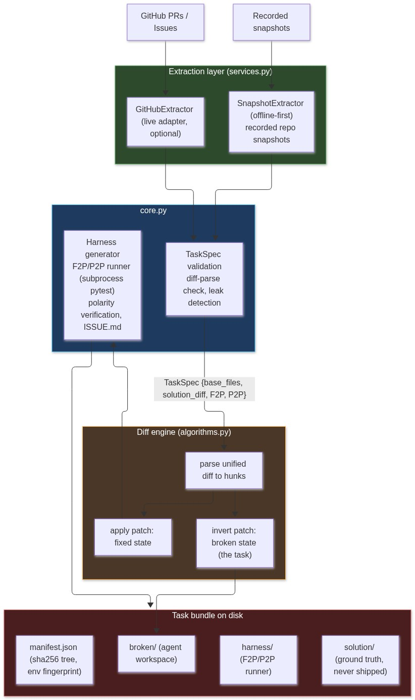
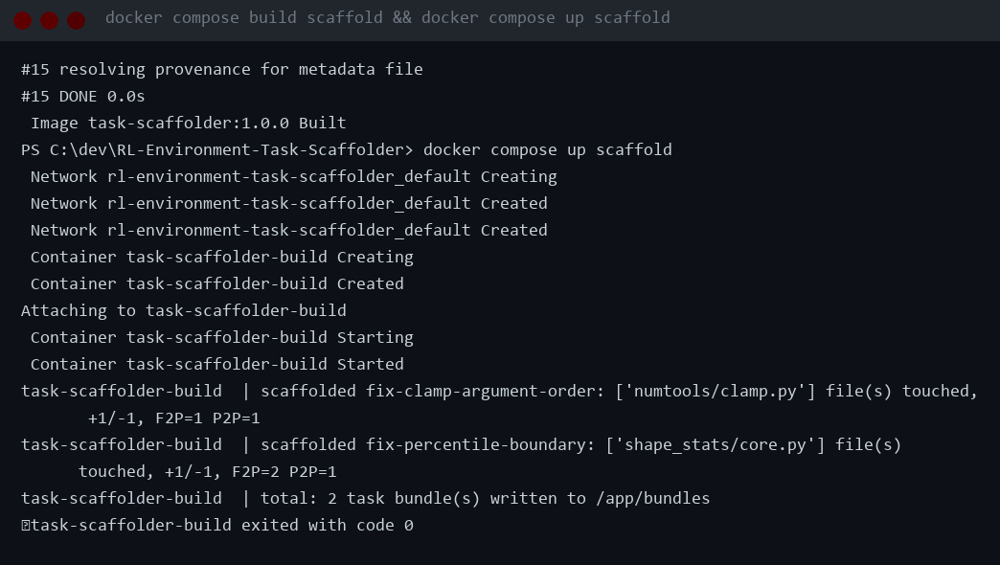
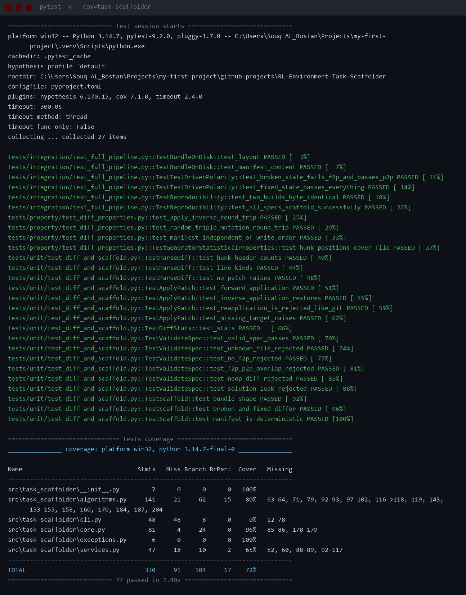
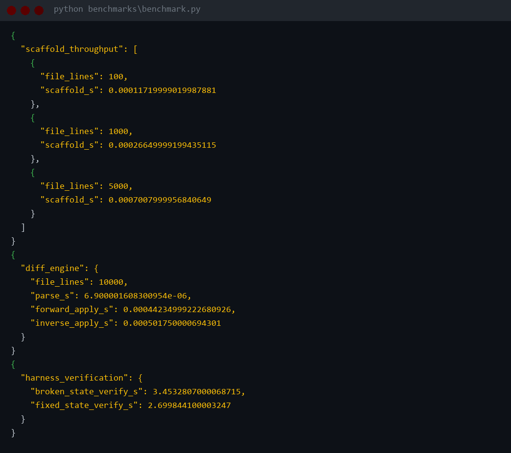

# RL-Environment-Task-Scaffolder

**A professional Python engineering project demonstrating reproducible environment construction, deterministic verification harnesses, and QA automation -- scaffolding coding-challenge environments for AI agents from real repository fixes.**

[](LICENSE)
[](https://opencode.ai)


## 1. Project Overview

**Problem.** Evaluating coding agents requires tasks that are (a) drawn
from real-world software, (b) unambiguously gradeable, and (c) exactly
reproducible. Hand-built "broken repo" fixtures drift, leak solutions,
and grade inconsistently.

**Why it is technically challenging.** Turning a real pull request into a
task requires mechanically inverting the fix into a broken state without
corrupting anything, generating a harness whose polarity (fail before /
pass after) is *proven*, and making every byte of the produced bundle
reproducible across operating systems.

**Solution.** A deterministic pipeline: recorded PR snapshots →
validation (with leak detection) → content-anchored diff engine that
synthesizes the broken state by inverse application → generated F2P/P2P
harness verified by real pytest subprocesses → sorted sha256 manifests.
CI proves byte-identical bundles across a 3-OS × 2-Python matrix.

## 2. Key Features

- Deterministic diff engine with `git apply`-equivalent refusal semantics
  (content-verified application, byte-exact inversion).
- Test-driven harness generation: F2P (fail-to-pass) and P2P
  (pass-to-pass) test ids with polarity re-verified from the emitted
  bundle on every CI run.
- Byte-identical reproducibility: sorted sha256 manifests, no timestamps,
  proven locally and across OSes.
- Solution-leak detection: specs whose issue text quotes the fix are
  rejected before scaffolding.
- Offline-first extraction (hermetic snapshots) with a live GitHub REST
  adapter sharing the same `TaskSpec` contract.
- Property-based diff round-trip testing on arbitrary mutation sites.
- Docker Compose end-to-end service: scaffold then verify both states.
- Cross-OS CI (ubuntu / windows / macos × Python 3.11/3.12).

## 3. System Architecture



Component view, data flow, and task lifecycle narrative:
[`docs/architecture.md`](docs/architecture.md) and
[`docs/task-lifecycle.md`](docs/task-lifecycle.md). Extraction →
validation → diff inversion → harness generation → manifest; the agent
receives `broken/`, ground truth stays in `solution/`.

## 4. Technology Stack

| Technology | Purpose |
|---|---|
| Python 3.11+ | Core implementation, full type hints |
| Unified-diff engine | Custom parser / apply / invert (no external diff tools) |
| Pytest | Harness execution + project test suite |
| Hypothesis | Property-based diff round-trip testing |
| GitHub REST API | Optional live extraction adapter |
| Ruff | Linting and code quality |
| MyPy (strict) | Static type checking |
| GitHub Actions | CI with cross-OS reproducibility matrix |
| Docker Compose | One-command reproducible environment |

## 5. Repository Structure

| Path | Purpose |
|---|---|
| `src/task_scaffolder/` | `core.py` (TaskSpec, harness, manifests), `algorithms.py` (diff engine), `services.py` (extractors), `cli.py`, `exceptions.py` |
| `tests/unit/` | Diff parsing, application, spec validation, scaffolding |
| `tests/property/` | Diff round-trips, order-independent manifests |
| `tests/integration/` | Bundle layout, F2P/P2P polarity on real pytest, reproducibility |
| `tests/fixtures/` | Two recorded task snapshots (broken states included) |
| `docs/` | Architecture, task lifecycle, reproducibility, design decisions, debugging log, security |
| `benchmarks/` | Scaffolding throughput, diff-engine cost, harness cost |
| `scripts/` | Setup and test runner |
| `.github/workflows/` | CI: 3-OS matrix, double-scaffold diff job, docker job |

## 6. Installation and Setup

```bash
git clone https://github.com/<you>/RL-Environment-Task-Scaffolder
cd RL-Environment-Task-Scaffolder

# Option A: zero-config Docker (recommended)
docker compose build

# Option B: local environment
python -m venv .venv
source .venv/bin/activate          # Windows: .venv\Scripts\activate
pip install -r requirements.txt
pip install -e .
```

Zero manual configuration; the pipeline is offline by default.

## 7. Execution

```bash
# Scaffold all task bundles from the recorded snapshots
docker compose up scaffold

# Verify both polarities of a bundle (broken must fail F2P; fixed must pass all)
docker compose up verify

# Or locally:
python -m task_scaffolder.cli scaffold \
    --snapshot-dir tests/fixtures/github_snapshots --out bundles/
python -m task_scaffolder.cli verify \
    --bundle bundles/fix-percentile-boundary --state broken
python -m task_scaffolder.cli verify \
    --bundle bundles/fix-percentile-boundary --state solution
```

Stop/tear down:

```bash
docker compose down
```



## 8. Testing and Verification

```bash
pytest -v
pytest --cov=task_scaffolder --cov-report=term-missing
```

Test layers:

- **Unit tests** -- hunk parsing, forward/inverse application, content
  verification, spec validation (including leak and no-op rejection),
  bundle shape, manifest determinism.
- **Property tests** -- for arbitrary files and arbitrary mutation
  sites: apply → inverse is byte-identical; compounded multi-patch
  round-trips; manifests independent of write order.
- **Integration tests** -- bundles written to disk, layout pinned, and
  the F2P/P2P polarity *actually executed* with real pytest
  subprocesses in both states; two scaffolds byte-identical.

Measured results: **27 tests, all passing**, including end-to-end
polarity verification; screenshot evidence in `docs/images/`.



## 9. Performance Benchmarking

Reproducible via `python benchmarks/benchmark.py`; details in
[`benchmarks/results.md`](benchmarks/results.md).

- Dataset: synthetic snapshots up to 10k lines, plus the real fixtures.
- Scaffolding a 5,000-line snapshot: **0.6 ms** (pipeline is hashing-
  dominated); 10k-line diff forward/inverse apply: **0.44 / 0.46 ms**.
- Harness verification (the real cost): ~2.4 s per state -- pytest
  subprocess startup dominates, with a 10x cut identified as future
  work (persistent test server).



## 10. Debugging and Problem Resolution

Documented with root causes in
[`docs/debugging-log.md`](docs/debugging-log.md):

- **Silent corruption on stale patches** caught by Hypothesis; fixed
  with content-anchored application (`git apply` semantics) and pinned
  by `test_reapplication_is_rejected_like_git`.
- **Windows BOM broke snapshot loading**; fixed with `utf-8-sig` reads
  and covered by the cross-OS CI matrix.
- **Fixture snapshots collected as tests** (their broken states fail by
  design); fixed with explicit collection ignores.
- **Harness double-nesting** in the bundle writer; pinned by layout
  integration tests.

## 11. Design Decisions

Full rationale in [`docs/design-decisions.md`](docs/design-decisions.md):

- **Snapshots over live pulls** for reproducibility, with a live
  adapter sharing the `TaskSpec` contract.
- **Diff inversion over stored broken states**: the fixed state is
  *defined* as broken + diff, making drift impossible.
- **F2P/P2P polarity as the correctness contract**, re-verified from
  emitted bundles, not just at generation time.
- **Leak detection at validation time**: an agent that can see the fix
  isn't taking the test.

## 12. Security Considerations

Documented in [`docs/security.md`](docs/security.md): snapshots are
untrusted input (validated, never executed at scaffold time), harness
subprocesses run only validated test ids with timeouts, no dynamic
evaluation anywhere (lint-enforced), tokens are explicit parameters, and
the honest limitation that bundle *contents* are provenance-hashed but
not signature-verified.

## 13. Limitations

- Binary-file diffs (images, compiled assets) are out of scope; the
  engine handles text diffs only.
- The live GitHub adapter requires upstream API affordances for
  pre-fix file content and is not exercised in CI (by design).
- Agent-side patch application is the consumer's responsibility; the
  bundle defines the contract, not the agent runtime.

## 14. Future Improvements

- Persistent pytest server to cut harness verification ~10x.
- Multi-commit PRs with staged F2P checkpoints.
- Bundle signing (provenance signatures on manifests).
- Additional extractors (GitLab, local git history) on the same
  `TaskSpec` contract.

## 15. License

MIT License -- see [LICENSE](LICENSE).
