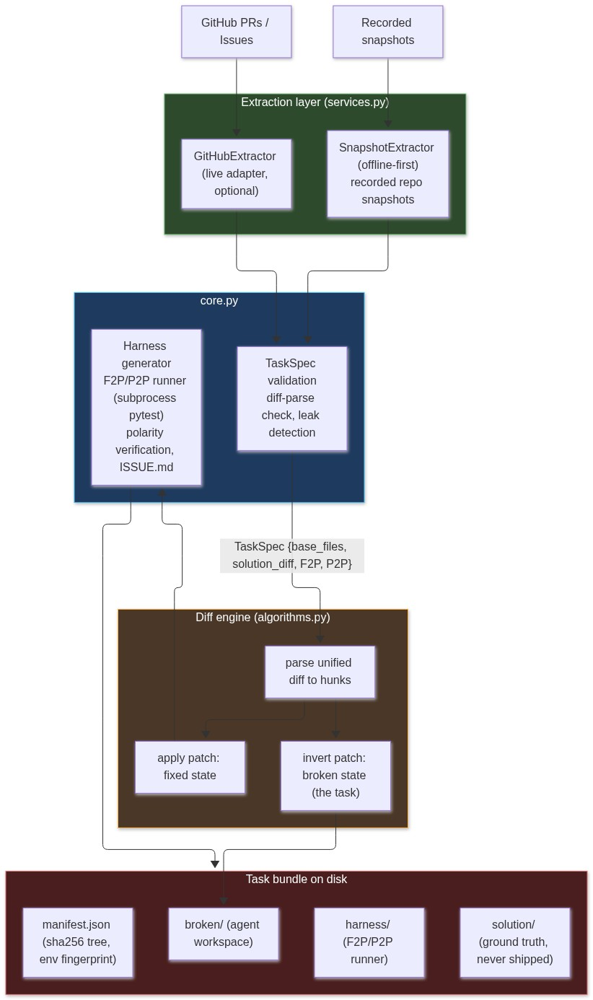

# System Architecture



## Pipeline view

```
GitHub PRs / Issues (real world)
        │  (recorded snapshots -- offline, deterministic)
        ▼
┌─────────────────────┐
│ Extraction layer    │   SnapshotExtractor (offline-first)
│ services.py         │   GitHubExtractor (live adapter, optional)
└──────────┬──────────┘
           │ TaskSpec {base_files, solution_diff, F2P, P2P, issue}
           ▼
┌─────────────────────┐
│ Validation          │   spec sanity, diff-parse check,
│ core.py             │   leak detection (issue ⊄ solution)
└──────────┬──────────┘
           ▼
┌─────────────────────┐
│ Diff engine         │   parse unified diff → hunks
│ algorithms.py       │   apply patch  → fixed state
│                     │   invert patch → broken state (the task)
└──────────┬──────────┘
           ▼
┌─────────────────────┐
│ Harness generator   │   F2P/P2P runner (subprocess pytest),
│ core.py             │   polarity verification, ISSUE.md
└──────────┬──────────┘
           ▼
┌────────────────────────────────────────────────────┐
│ Task bundle on disk                                │
│  broken/   ← agent workspace (pre-fix state)       │
│  solution/ ← ground truth (never shipped to agent) │
│  harness/  ← F2P/P2P verification runner           │
│  manifest.json ← sha256 tree + env fingerprint     │
└────────────────────────────────────────────────────┘
```

## Task lifecycle

Full narrative in [`task-lifecycle.md`](task-lifecycle.md). Summary:

1. **Extract** -- a recorded PR snapshot (files + issue + solution patch)
   becomes a `TaskSpec`. Snapshots are the single source of truth;
   the pipeline is hermetic and offline by default.
2. **Validate** -- malformed diffs, unknown files, empty F2P sets, and
   issue-text solution leaks are rejected before anything is produced.
3. **Invert** -- the solution diff is *applied backwards* to synthesize
   the broken pre-fix state; content verification rejects stale patches
   exactly like `git apply`.
4. **Harness** -- a generated runner executes each F2P/P2P test in a
   subprocess and asserts the polarity: F2P fail + P2P pass in `broken/`,
   all pass in `solution/`.
5. **Manifest** -- sha256 of every file, sorted, timestamp-free: two
   scaffolds of the same spec are byte-identical on any OS.

## Design intent

The extraction layer is a *pure adapter*: identical inputs produce
identical `TaskSpec`s regardless of source (snapshot replay or live
GitHub). Everything downstream -- diff engine, harness, manifests --
depends only on the `TaskSpec` contract, so new sources (GitLab, local
git history) can be added without touching the verified core.
